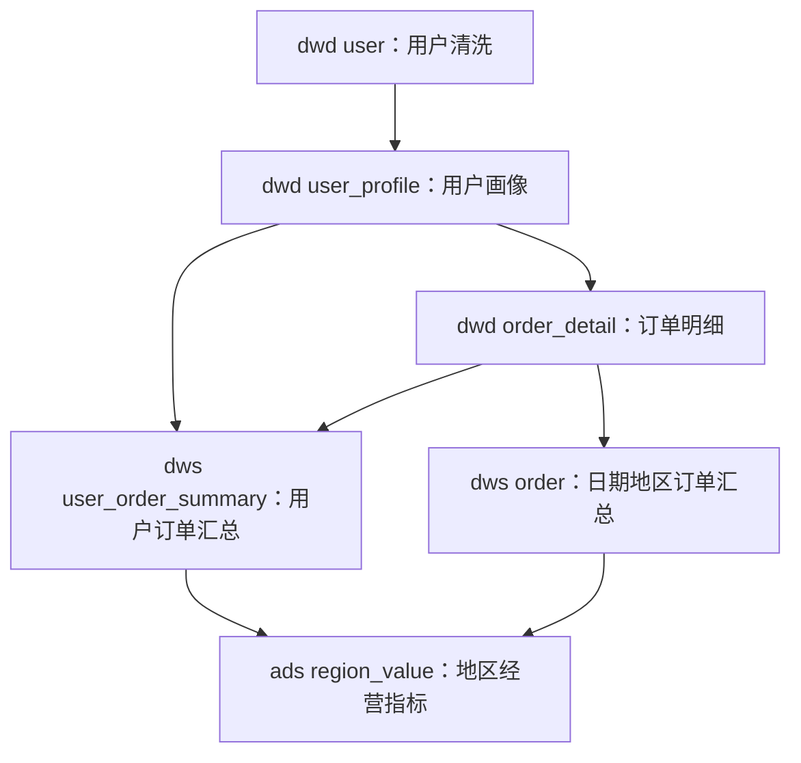

# spark-dbt-example

`spark-dbt-example` 是借鉴 dbt 项目组织方式的 Spark SQL 开发框架示例：按数仓分层组织 SQL，
用 YAML 管理作业配置，通过统一启动脚本运行独立的 Spark 作业。
`bin/` 下的启动脚本和 `lib/` 下的 JAR 由平台组提供和支持；其他目录及工程配置文件由项目组自行维护。

业务开发请先阅读[开发者手册](/Users/ywzhang/github_project/spark_sdp/docs/SQL_SDP_DEVELOPER_GUIDE.md)，
了解项目目录、SQL 与作业配置、测试方法及工作流配置。

[框架说明](docs/FRAMEWORK.md) 介绍模块职责、配置规则、提交过程、依赖管理及开发约定。
本文提供六个关联数仓样例的执行方法和预期结果。另有 [Hudi MOR 维护样例](docs/HUDI-COMPACTION.md)和 [DolphinScheduler 生成与发布说明](docs/DOLPHINSCHEDULER.md)。

## 目录结构

```text
spark-dbt-example/
├── README.md
├── docs/FRAMEWORK.md            # 框架说明
├── dbt_project.yaml             # DS 项目及公共调度配置
├── properties/                  # application.properties：当前部署环境的公共 Spark 配置
│                               # application-sit.properties、application-uat.properties：DS 同步配置
├── lib/                         # 平台组支持：JAR 依赖
│   ├── spark-sdp-1.0.jar        # 框架运行包
│   └── spark-connector-1.0.jar  # 连接器依赖
├── bin/                         # 平台组支持：启动脚本
│   ├── start_pipeline_job.sh    # 统一入口：分层 + 作业名，仅两个参数
│   └── ds-sync.sh               # 单工作流生成及版本发布入口
├── models/
│   ├── dwd/
│   │   ├── user.sql            # 用户清洗
│   │   ├── user_profile.sql    # 新增：用户画像补充
│   │   └── order_detail.sql    # 新增：有效支付订单明细
│   ├── dws/
│   │   ├── order.sql           # 日期、地区订单汇总
│   │   └── user_order_summary.sql # 新增：用户订单汇总和价值等级
│   ├── ads/
│   │   └── region_value.sql    # 地区经营指标
│   └── sdf_compaction/
│       └── mor_table.sql       # Hudi MOR 表维护清单
├── config/                     # 与 models 保持同层级、同名的作业 YAML
│   ├── dwd/                    # user.yaml、user_profile.yaml、order_detail.yaml
│   ├── dws/                    # order.yaml、user_order_summary.yaml
│   ├── ads/                    # flow.yaml、region_value.yaml
│   └── sdf_compaction/         # flow.yaml、mor_table.yaml
└── tests/sql/
    ├── setup.sql               # 创建三层测试库及六张目标表
    ├── reset.sql               # 清空六张专用测试表
    └── verify.sql              # 断言六张表的完整预期结果
```

`models/` 下的每个目录是一组作业，也表示数仓层次；支持 `dws/trade` 等多级业务目录。
每个 SQL 文件对应一个独立 Spark 作业。各目录的 `flow.yaml` 由 `ds-sync.sh` 读取，
生成当前工作流内部的 DS DAG 和定时；`start_pipeline_job.sh` 仍按原有单文件方式执行。

## 样例依赖



| 启动参数 | 直接上游作业 | 目标表 | 预期行数 |
| --- | --- | --- | --- |
| `dwd user` | 内置原始用户数据 | `spark_dbt_example_dwd.user` | 3 |
| `dwd user_profile` | `dwd user` | `spark_dbt_example_dwd.user_profile` | 3 |
| `dwd order_detail` | `dwd user_profile`，内置原始订单数据 | `spark_dbt_example_dwd.order_detail` | 4 |
| `dws order` | `dwd order_detail` | `spark_dbt_example_dws.order_summary` | 3 |
| `dws user_order_summary` | `dwd user_profile`、`dwd order_detail` | `spark_dbt_example_dws.user_order_summary` | 3 |
| `ads region_value` | 两个 DWS 作业 | `spark_dbt_example_ads.region_value` | 2 |

用户画像演示在 `user` 清洗完成后继续加工。订单明细集中执行订单过滤与用户关联，
原有 `dws/order.sql` 已改为读取该明细，汇总结果保持不变。两个 DWS 作业可以在订单明细
成功后并行执行，ADS 必须等待两个 DWS 作业均成功。

这些依赖通过持久化表传递数据。启动脚本每次提交一个作业，不自动补跑上游、检查数据批次
或调度整张依赖图。生产环境需在外部调度系统中按图建立依赖。

## 作业启动

使用平台提供的 SQL 工程模板，在工程根目录执行：

```bash
./bin/start_pipeline_job.sh dws order
```

该入口只接收模型目录和作业名两个参数，不需要也不接受其他提交参数。
脚本自动加载：

- `lib/spark-sdp-1.0.jar`：框架运行包。
- `lib/spark-connector-1.0.jar`：连接器。
- `models/dws/order.sql`：本次执行的 SQL。
- `config/dws/order.yaml`：本次作业配置。
- `properties/application.properties`：当前部署环境的公共 Spark 配置。

脚本按自身位置定位工程，配置中的相对依赖路径按工程根目录解析。
`bin/`、`lib/` 由平台组支持，其他目录和工程配置由项目组自行维护。
运行包或连接器缺失时联系平台组，SQL、作业 YAML 和环境配置缺失时由项目组补齐。

多级目录按同样规则使用：

```bash
./bin/start_pipeline_job.sh dws/trade order
```

在相应目录创建 SQL 和 YAML 后即可运行。运行资源、队列和作业参数写在作业 YAML 中；
公共 Spark 参数写在 `properties/application.properties`，例如：

```properties
spark.yarn.submit.waitAppCompletion=true
spark.jars=lib/spark-connector-1.0.jar
# spark.files=/etc/hive/conf/hive-site.xml
```

项目组按部署环境维护该文件，命令不传环境参数。SIT/UAT 的 DS 配置仍由
`ds-sync.sh generate . ads sit` 等命令选择，不作为业务作业的环境文件加载。

## 测试操作

### 初始化及重跑准备

样例使用固定内置数据，无需准备源表。先在测试环境执行：

```bash
spark-sql -f tests/sql/setup.sql
```

初始化会话与六个 Spark 作业必须连接同一个 Hive metastore，能访问相同的表存储路径。
建表语句位于 `tests/sql/`，通过 `spark-sql` 执行；不要经 `start_pipeline_job.sh` 作为模型提交。

全部样例使用 `INSERT INTO` 追加写入，不自动去重。首次使用空表；重跑整条链之前，
确认可以丢弃测试数据后执行：

```bash
spark-sql -f tests/sql/reset.sql
```

该文件只清空六张 `spark_dbt_example_*` 测试表。重复写入上游会导致下游关联放大，
因此完整测试需清空所有表并按依赖重跑，不能仅清空最终 ADS 表。

### 按依赖提交

下列命令展示提交顺序。**每一步须确认上游 YARN 作业成功完成后再运行下一步**，
不要直接依赖提交进程返回来假定数据已就绪；尤其要检查是否配置为异步提交。

```bash
./bin/start_pipeline_job.sh dwd user
./bin/start_pipeline_job.sh dwd user_profile
./bin/start_pipeline_job.sh dwd order_detail
./bin/start_pipeline_job.sh dws order
./bin/start_pipeline_job.sh dws user_order_summary
./bin/start_pipeline_job.sh ads region_value
```

需要分发 Hive 配置时，在 `properties/application.properties` 中配置 `spark.files`，或在作业 YAML 中配置 `spark-submit.files`。
失败时停止对应下游作业；重试前确认失败作业是否已写入数据。

### 断言与预期结果

六个作业成功后执行：

```bash
spark-sql -f tests/sql/verify.sql
```

校验包括每张表的行数和每行字段，成功时六条 `assert_true` 均返回 `NULL`，不匹配时报告
对应表名。用户清洗、过滤、金额精度、去重用户计数、价值等级和多上游关联均有固定结果。

用户清洗与画像结果：

| user_id | user_name | region | region_group（画像） | name_length（画像） |
| --- | --- | --- | --- | --- |
| 1 | Alice | east | east_cn | 5 |
| 2 | Bob | south | south_cn | 3 |
| 3 | Charlie | east | east_cn | 7 |

有效订单为 `1001`、`1002`、`1003`、`1004`。取消、负金额、零金额、未知用户、
姓名被过滤用户的订单不进入明细。日期地区汇总仍为：

| order_date | region | order_count | user_count | total_amount |
| --- | --- | --- | --- | --- |
| 2026-01-01 | east | 2 | 1 | 150.50 |
| 2026-01-01 | south | 1 | 1 | 80.00 |
| 2026-01-02 | east | 1 | 1 | 120.00 |

用户订单汇总：

| user_id | user_name | region | order_count | total_amount | last_order_date | value_level |
| --- | --- | --- | --- | --- | --- | --- |
| 1 | Alice | east | 2 | 150.50 | 2026-01-01 | HIGH |
| 2 | Bob | south | 1 | 80.00 | 2026-01-01 | STANDARD |
| 3 | Charlie | east | 1 | 120.00 | 2026-01-02 | STANDARD |

最终地区指标：

| region | user_count | high_value_user_count | order_count | total_amount | avg_order_amount | first_order_date | last_order_date |
| --- | --- | --- | --- | --- | --- | --- | --- |
| east | 2 | 1 | 3 | 270.50 | 90.17 | 2026-01-01 | 2026-01-02 |
| south | 1 | 0 | 1 | 80.00 | 80.00 | 2026-01-01 | 2026-01-01 |

用户累计金额达到 `150.00` 为 `HIGH`。地区用户数统计全部有效用户；地区平均订单金额为
有效支付金额除以订单数，使用 `DECIMAL(18,2)`。ADS 先将两侧聚合至地区粒度再关联，
避免同一地区的多用户、多日期记录互相放大。

### 在一个本地 Spark 会话验证 SQL 链路

以下操作验证 SQL 和结果，不经过 Java 提交入口。请在独立的本地测试 metastore、warehouse
中执行，合并文件包含对专用测试表的清空操作：

```bash
check_sql="$(mktemp /tmp/spark-dbt-check.XXXXXX)"
cat tests/sql/setup.sql \
    tests/sql/reset.sql \
    models/dwd/user.sql \
    models/dwd/user_profile.sql \
    models/dwd/order_detail.sql \
    models/dws/order.sql \
    models/dws/user_order_summary.sql \
    models/ads/region_value.sql \
    tests/sql/verify.sql > "$check_sql"
spark-sql --master 'local[2]' --conf spark.sql.shuffle.partitions=2 -f "$check_sql"
rm "$check_sql"
```

## DolphinScheduler 生成与发布

配置 `properties/application-sit.properties` 或 `application-uat.properties` 后执行：

```bash
./bin/ds-sync.sh generate . ads sit
./bin/ds-sync.sh apply . ads sit
./bin/ds-sync.sh generate . ads uat
./bin/ds-sync.sh generate . sdf_compaction sit
```

必须依次传入 `generate/apply projectHome workflowHome env`，不设置默认工程或默认环境。`generate` 离线解析指定工作流并写出 JSON；`apply` 每次创建带时间戳的新版本，
配置定时并切换本工具管理的旧版本定时，不更新旧工作流定义。
示例项目编码 `0` 只能用于生成，发布前填入真实 DS 项目编码并在所选环境文件中填写 `ds.api.token`。
默认 `ds.schedule.enabled=false`，发布后的新定时保持停用，并停用该逻辑工作流的旧定时。

生成工具只管理当前工作流内部依赖，其他工作流的表作为外部输入，仍需保证数据就绪。
DS 节点统一为 `SHELL`，进入 Worker 上工程根目录后执行：

```sh
./bin/start_pipeline_job.sh ads region_value
./bin/start_pipeline_job.sh sdf_compaction mor_table
```

统一入口根据分层、任务名定位 SQL/YAML，生成具体 `spark-submit` 命令。
环境、告警、部署路径、发布记录及恢复规则见 [DS 对接文档](docs/DOLPHINSCHEDULER.md)。

## Hudi MOR compaction 作业

`models/sdf_compaction/mor_table.sql` 指定 `sdf.user`、`sdf.alter` 两张示例表；
`config/sdf_compaction/mor_table.yaml` 使用 `job-type: hudi-compaction`。
替换为真实测试 MOR 表、确认已有计划及运行环境支持所需维护 SQL 后，可执行：

```bash
./bin/start_pipeline_job.sh sdf_compaction mor_table
```

此任务复用现有 Spark SQL 维护入口，不创建新 compaction 计划，且当前入口会继续执行 clean、
archive。SQL 能力、状态检查限制、参数与 DS 配置详见 [Hudi 维护说明](docs/HUDI-COMPACTION.md)。
