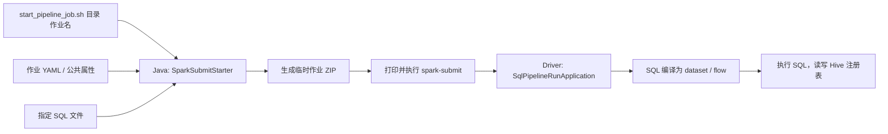

# Spark SQL 开发框架说明

本模块将 SQL 文件、作业配置和提交入口组织成可独立部署的 Spark SQL 项目。
业务开发集中在 `spark-dbt-example`，执行能力复用仓库的 `spark-core`。
[README](../README.md) 提供六个有上下游关系的样例、建表脚本和完整预期结果。

## 模块职责

SQL 工程中，平台组负责 `bin/` 下脚本和 `lib/` 下 JAR 的提供、维护与支持。
项目组自行维护其他目录及工程配置，包括业务 SQL、作业配置、环境属性、测试和文档。

| 位置 | 职责 | 当前行为 |
| --- | --- | --- |
| `models/` | 数仓分层及业务 SQL | 一个文件对应一个 Spark 作业 |
| `config/` | 对应作业的运行配置 | 按相同目录、文件名映射 YAML |
| `bin/start_pipeline_job.sh` | 手工执行和 DS 调度统一入口 | 仅接收分层和作业名两个参数 |
| `lib/` | 平台提供的框架运行包和连接器 | `spark-sdp-1.0.jar`、`spark-connector-1.0.jar` |
| `tests/sql/` | 测试表初始化、清空及结果断言 | 使用 `spark-sql` 执行 |
| `docs/` | 开发和运行约定 | 记录能力、边界和样例依赖 |
| `dbt_project.yaml` | DS 项目及公共调度配置 | 由 `ds-sync.sh` 加载 |
| `properties/` | 当前环境和 DS 同步配置 | application.properties 配置公共 Spark 参数；分环境文件配置 DS |
| `bin/ds-sync.sh` | 工作流生成与发布 | 单次处理一个目录，发布时新建版本 |
| `config/*/flow.yaml` | 工作流配置 | 定义工作流、节点默认设置及定时 |
| `spark-core` | SQL 加载、编译、运行及提交命令构造 | 提供运行时 JAR |

本模块不含 Java 源码、不引入运行时 Maven 依赖、不生成 JAR。
借鉴的是 dbt 的 SQL 项目组织思路；当前没有实现 `ref()`、Jinja、宏、dbt CLI、
自动物化策略或 dbt 测试协议。DS 节点配置支持工程、工作流、作业三级覆盖，
完整规则见 [DolphinScheduler 对接](DOLPHINSCHEDULER.md)。

## 目录和命名映射

`models/` 的目录代表一组作业，同时表达数仓层次。当前样例包含：

- DWD：用户清洗、用户画像补充、有效支付订单明细。
- DWS：日期地区订单汇总、用户订单汇总。
- ADS：面向地区经营分析的指标结果。
- sdf_compaction：Hudi MOR 表的已有计划维护，见 [Hudi 说明](HUDI-COMPACTION.md)。

可以进一步建立 `models/dws/trade/` 等业务域目录，配置目录同步增加对应层级。
建议 SQL 使用描述加工结果的名称，目标表显式写出数据库前缀，避免默认数据库变化影响读取与写入。

```text
start_pipeline_job.sh dws user_order_summary
  -> models/dws/user_order_summary.sql
  -> config/dws/user_order_summary.yaml

start_pipeline_job.sh dws/trade order
  -> models/dws/trade/order.sql
  -> config/dws/trade/order.yaml
```

执行命令只接收分层和作业名，SQL 和作业 YAML 按同名规则定位，不接受额外提交参数。
目录与作业名由脚本拼接成 SQL 文件路径；YAML 中的 `transformation` 不参与本脚本的单文件选择。

## 作业配置

配置示例：

```yaml
name: spark_dbt_example_dws_user_order_summary
job-type: spark-sql
# 可选：设置非完整限定表名使用的默认数据库
# database: spark_dbt_example_dws
configuration:
  spark.sql.shuffle.partitions: "2"
spark-submit:
  master: yarn
  deploy-mode: cluster
  queue: default
  driver.memory: 1g
  executor.num: "1"
  executor.memory: 1g
  executor.cores: "1"
```

| 配置项 | 用途 |
| --- | --- |
| `name` | Pipeline 名称，默认也用于 Spark/YARN 应用名 |
| `job-type: spark-sql` | 选择 SQL 作业执行逻辑 |
| `database` | SQL 运行时默认数据库，可省略 |
| `configuration` | 传给运行时 SparkSession 的配置 |
| `spark-submit` | 提交机调用 `spark-submit` 时的参数 |
| `spark-submit.conf.spark.*` 或 `spark-submit.spark.*` | 映射成提交命令的 `--conf spark.*=...` |

`configuration` 与提交参数分别由运行入口和提交入口读取。driver/executor 的内存、核数、
队列和需要在 SparkContext 创建前生效的提交参数，应配置在 `spark-submit` 中。
若同一个 Spark 配置出现在多个位置，应统一取值，减少提交阶段和运行阶段的差异。

启动脚本固定加载 `properties/application.properties`，作为当前部署环境的公共 Spark 配置：

```properties
spark.yarn.submit.waitAppCompletion=true
spark.jars=lib/spark-connector-1.0.jar
# spark.files=/etc/hive/conf/hive-site.xml
```

执行时无需指定文件参数：

```bash
./bin/start_pipeline_job.sh dws user_order_summary
```

脚本自动定位 `lib/` 中的运行包和连接器，以及同名 SQL/YAML；校验文件后进入工程根目录，
将 SQL、作业配置和环境配置交给提交入口。环境文件提供默认值，作业 YAML 的同名提交配置优先。
若作业单独配置依赖列表，应保留所需连接器。

`start_pipeline_job.sh` 不读取工程级 DS 调度配置，每个作业 YAML 仍需包含完整的 Spark 资源配置。
`ds-sync.sh` 读取 `dbt_project.yaml`、所选环境的 DS properties、所选 `flow.yaml`，并校验
`application.properties` 中的 YARN 等待完成设置；分环境 DS 属性不会作为 Spark 参数传入。

## 从启动到执行



脚本先检查参数、SQL/YAML 可读性及非空状态，再定位运行时 JAR 和 Java，最后使用
`exec` 启动 `com.bocom.rdss.spark.sdp3x.starter.SparkSubmitStarter`。
参数以 Bash 数组传递，包含空格的路径也作为单个参数保留。

Java 提交入口负责：

1. 读取作业 YAML 和可选公共属性，解析提交资源。
2. 将 YAML 及本次 SQL 打入临时 ZIP；SQL 放在归档中的 `task/` 目录。
3. 构造带 `--archives ...#spark-sdp-job` 的 `spark-submit` 命令。
4. 以 `Executing: ...` 打印命令，启动提交进程并等待其退出。

单文件模式只归档指定 SQL 和作业 YAML，不扫描同目录其他模型，不把上游作业一起提交。
生产 driver 的入口是 `com.bocom.rdss.spark.sdp3x.sql.SqlPipelineRunApplication`，
从分发的归档中读取 SQL/YAML，配置 SparkSession 并执行作业。

`SqlPipelineParser` 将支持的 SQL 声明转换为定义，`SqlPipelineProjectCompiler` 生成
已有的 dataset/flow 模型，运行入口交给 `PipelineOrchestrator.runInDeclarationOrder` 执行。
当前该入口按声明顺序执行文件内语句，不能把 SQL 依赖抽取或执行计划展示等同于
跨多个独立 Spark 作业的自动拓扑调度。

## SQL 能力与约定

当前模型解析器接受 `INSERT INTO [TABLE] ... SELECT ...`、`CREATE MATERIALIZED VIEW ... AS ...`、
`CREATE TEMPORARY VIEW ... AS ...` 和 `TRUNCATE TABLE ...` 等声明。
已有 `SET` 语句会被接受但跳过，作业配置以 YAML 为准。样例统一使用 `INSERT INTO`。

解析器并非任意 Spark SQL 的透明转发入口。建库、建表、独立查询、`INSERT OVERWRITE`、
`MERGE` 等未在当前模型解析器中提供对应声明处理。测试建表与结果查询放在 `tests/sql/`，
通过 `spark-sql` 单独执行，不作为生产模型传给 `start_pipeline_job.sh`。

目标表由外部提前创建，字段顺序和类型与 `INSERT ... SELECT` 结果保持一致。
金额使用 `DECIMAL`，避免浮点汇总误差；跨作业数据通过持久化表传递，临时视图不能用于
不同 Spark 应用之间的数据交接。

运行入口已有的 SQL 定义依赖抽取是轻量实现；新增 DS 生成器使用 Spark SQL 未解析语法树，
用于当前工作流内的依赖识别，支持 CTE、子查询和表达式子查询。
常见表依赖可用于框架内的定义与分析；复杂 CTE、别名和模板场景需单独验证。
本样例采用限定表名与子查询，SQL 文件开头记录直接上游、目标及预期结果。

## 跨作业依赖与数据就绪

六个样例的实际依赖与结果见 [README](../README.md#样例依赖)。重点是：
`user_profile` 消费 `user` 的清洗结果；订单明细依赖画像；两个 DWS 汇总共享订单明细；
ADS 作业需要同时消费两个 DWS 作业的输出。

`ds-sync.sh` 自动建立所选工作流内部的作业依赖。不同工作流之间的数据依赖仍由外部系统控制，
当前不会自动启动或等待其他工作流。表存在或能查询成功，也不代表本批上游数据已就绪。

DS 节点统一使用 `SHELL` 类型，每个节点对应一次 `./bin/start_pipeline_job.sh <分层> <任务名>` 调用，将多个上游都成功设置为下游触发条件，
并统一数据批次及完成标志。两个 DWS 节点在订单明细完成后可并行，ADS 等两者均成功后执行。
上游失败时停止依赖它的下游，避免读取旧数据或部分数据。

`SparkSubmitStarter` 等待的是 `spark-submit` 进程，脚本传递该进程的退出码。
是否等待 YARN 应用结束还取决于提交配置，例如 `spark.yarn.submit.waitAppCompletion`。
调度器应跟踪对应应用的最终状态，不能在异步提交返回后直接放行下游。

## 写入、重跑与测试

六个数仓样例使用追加写入，不提供跨作业事务或自动幂等处理。用户明细重复会放大订单关联，
多次汇总会继续向下游传播重复结果。样例采用以下重跑方法：

1. 确认专用测试表的数据可以丢弃，执行 `tests/sql/reset.sql`。
2. 按 README 的依赖顺序从用户清洗开始重跑六个作业。
3. 执行 `tests/sql/verify.sql`，逐表验证固定预期行。

生产作业需根据业务另行设计分区、去重、批次标识和重跑策略。
失败重试前先确认是否已有写入，特别是提交客户端异常或连接中断后，不要直接假定写入未发生。

测试文件的职责分开：`setup.sql` 只创建数据库和表，`reset.sql` 清空六张测试表，
`verify.sql` 用固定预期值校验行数及字段，能发现重复行、过滤错误、聚合错误和关联放大。
六个作业完整执行后的测试行数分别为 `3 / 3 / 4 / 3 / 3 / 2`。

## 部署与排查

提交机需具备可用 Java、Spark、Hadoop 配置和集群连接；所有作业需共享 metastore 和表存储。
通过环境属性 `spark.files`、`spark.jars` 或作业 YAML 的提交配置管理文件和依赖。`JAVA_HOME` 选择提交入口
JDK，未设置则使用 `PATH` 的 Java；提交入口 JVM 参数可使用 `JAVA_TOOL_OPTIONS`。
Spark driver/executor 资源使用 YAML 的提交配置。

使用平台提供的运行包，默认位于 `lib/spark-sdp-1.0.jar`。
`lib/spark-connector-1.0.jar` 加入启动进程类路径，并由环境文件中的 `spark.jars` 配置分发给 Spark。
业务工程保留模型、配置、脚本和运行包；初始化和校验文件可按需一并部署。

| 现象 | 检查内容 |
| --- | --- |
| SQL/YAML missing、unreadable、empty | 目录和作业名映射、文件内容及权限 |
| Runtime jar not found | 联系平台组补齐 `lib/` 下的运行包和连接器 |
| 表不存在 | 先初始化，确认共享 metastore 及数据库前缀 |
| 下游结果为空或仍是旧批次 | 检查直接上游是否成功完成、本批数据是否就绪 |
| 金额或计数成倍增加 | 检查是否重复追加，上游主键是否唯一，关联粒度是否一致 |
| Unsupported SQL statement | 确认语句属于当前 Pipeline 解析器支持范围 |
| 提交成功后作业失败 | 查看 YARN 最终应用状态与 driver 日志 |

当前已支持将单个工作流内部的多作业 DAG 发布到 DS，每次发布新建版本。
尚未提供跨工作流调度、增量物化、跨作业原子提交或自动数据质量门禁。
发布流程、定时切换和失败恢复见 [DS 对接文档](DOLPHINSCHEDULER.md)。
